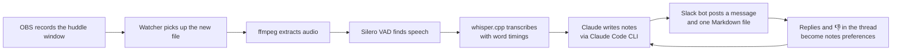

# Call Recaps — meeting notes for Slack huddles

Record a Slack huddle, and a few minutes later the team channel gets **one file**: detailed notes by topic (current status, decisions and why, deadlines, open questions, next steps), followed by the full timestamped transcript. Like Granola or Gemini Notes, but self-hosted: audio and video stay on the machine, only the transcript text goes to Claude.

The user does two things: press **Start recording** in OBS before the call and **Stop recording** after it.

## How it works



| Step | What happens |
|---|---|
| Watch | A watcher waits until a new recording stops growing, then takes it into work; failed files are retried. On Windows a toast says a recording was picked up. |
| Language | Whisper listens to short samples at 20, 50 and 80 % of the call, so silence at the start does not fool language detection. Can be pinned to one language. |
| Speech → text | whisper.cpp `large-v3-turbo` with Silero VAD. Without VAD, whisper invents or loops a phrase over long silence; repeated segments are also filtered after transcription. |
| Notes | Claude (Opus or Sonnet, set in `.env`) via `claude -p`: summary, topic sections with timestamps, next steps with owners only when the call names them. Notes are always in Russian, the transcript is in the call's language. |
| Delivery | Slack bot posts the call title and uploads a single `.md` file. If notes fail, the transcript still arrives and notes follow later. |
| Feedback loop | Replies under the bot's message ("shorter", "add dates to tasks") are saved as team preferences and sent to Claude with every next call. A 👎 without words makes the bot ask what was wrong. No fine-tuning, just context. |
| Speakers (off by default) | Code to name speakers from highlighted video tiles, avatars and voice embeddings (wespeaker ResNet34). Turned off because it mislabelled people on the production machine; `HUDDLE_SPEAKERS=on` enables it. |

## Engineering

- **Python 3.12**, `slack-sdk`, `sherpa-onnx`, ffmpeg, whisper.cpp, Claude Code CLI.
- **One place for models.** All model choices live in `.env`; `huddle-notes models` lists options and `models download` fetches and verifies them.
- **Regression check before deploy.** `deploy.sh <tag>` builds the tagged version, runs it against accepted reference calls and rolls back automatically if any result differs.
- **Hardened container.** Docker image runs read-only, with all capabilities dropped and `no-new-privileges`.
- **CI on every push:** ruff (lint and format), mypy, pytest on Linux and Windows, shellcheck, Docker build. Dependabot keeps dependencies current.
- **Privacy by design.** Recordings, names, face and voice prints and tokens never enter the repository. Biometric speaker data is off unless explicitly enabled.

## CLI

```bash
huddle-notes watch                     # process every new recording and send results to Slack
huddle-notes process call.mkv          # one recording → one document in the results folder
huddle-notes models [download]         # show / download the configured models
huddle-notes regress <folder>          # compare speaker naming with accepted transcripts
huddle-notes notify-test               # show a trial Windows notification
```

## Setup

```bash
python3.12 -m venv .venv && source .venv/bin/activate
pip install -e ".[dev]"
cp .env.example .env        # models, Slack token and channel, glossary, language
huddle-notes models download
huddle-notes watch
```

You also need ffmpeg, the whisper.cpp command line tool and a signed-in Claude Code (`claude`). The Slack app needs the `chat:write` and `files:write` bot scopes.

Step-by-step guides (in Russian): [install on a Windows PC](docs/install.md), [development](docs/development.md).
